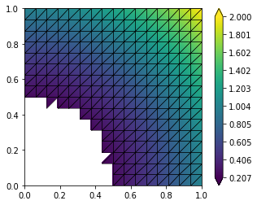
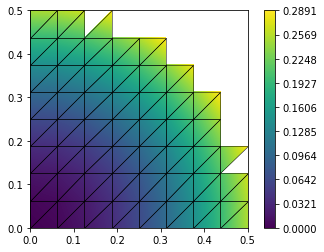
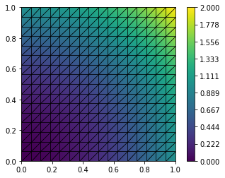

.. code:: ipython3

    from ufl import SpatialCoordinate, dot
    from dune.grid import cartesianDomain
    from dune.alugrid import aluConformGrid as leafGridView
    from dune.fem.view import filteredGridView
    from dune.fem.space import lagrange
    
    gridView = leafGridView( cartesianDomain([0,0],[1,1],[16,16]) )
    
    filteredView = filteredGridView(gridView, lambda e: e.geometry.center.two_norm > 0.5, domainId=1)
    space = lagrange(filteredView, order=2)
    x = SpatialCoordinate(space)
    solution = space.interpolate(dot(x,x),name="solution")
    solution.plot()
    print("number of dofs:", solution.size,\
          "integral over filtered domain",solution.integrate())
    
    filteredView = filteredGridView(gridView, lambda e: e.geometry.center.two_norm < 0.5, domainId=1,
                                    useFilteredIndexSet=True)
    space = lagrange(filteredView, order=2)
    x = SpatialCoordinate(space)
    solution = space.interpolate(dot(x,x),name="solution")
    solution.plot()
    print("number of dofs:", solution.size,\
          "integral over filtered domain",solution.integrate())
    
    space = lagrange(gridView, order=2)
    solution = space.interpolate(dot(x,x),name="solution")
    solution.plot()
    print("number of dofs:", solution.size,\
          "integral over filtered domain",solution.integrate())

.. parsed-literal::

    number of dofs: 1089 integral over filtered domain 0.6413014729817705

.. parsed-literal::

    number of dofs: 239 integral over filtered domain 0.025365193684895825

.. parsed-literal::

    number of dofs: 1089 integral over filtered domain 0.6666666666666667

